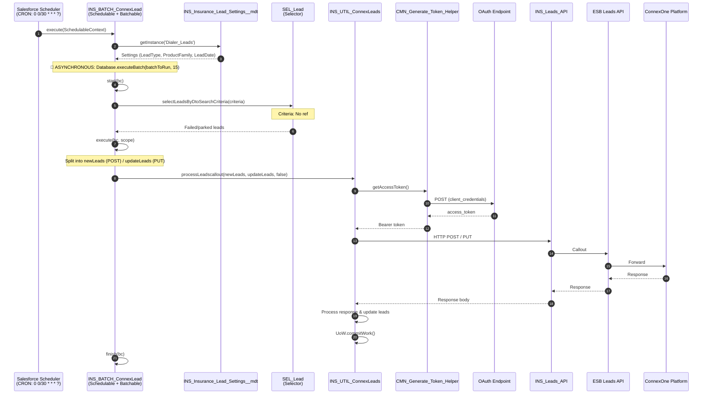
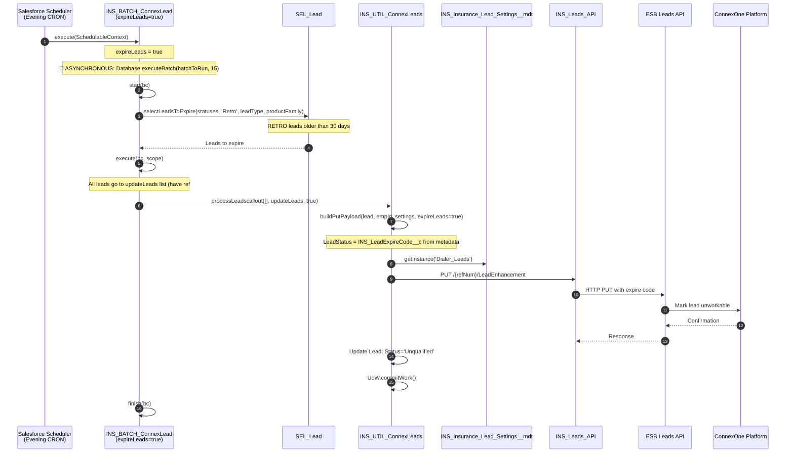
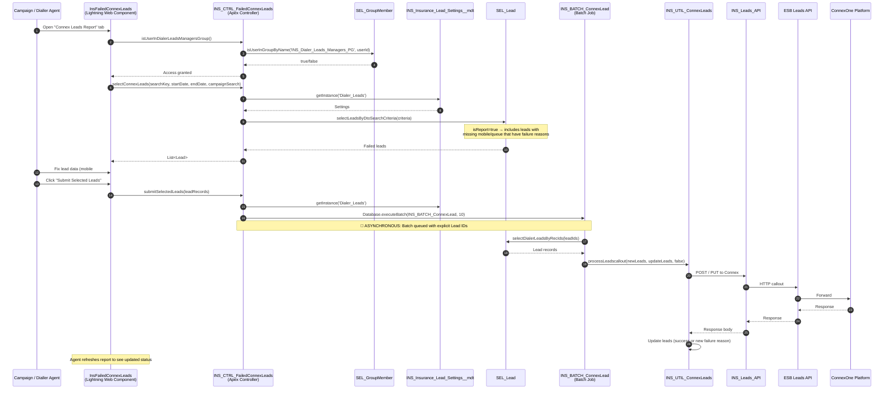
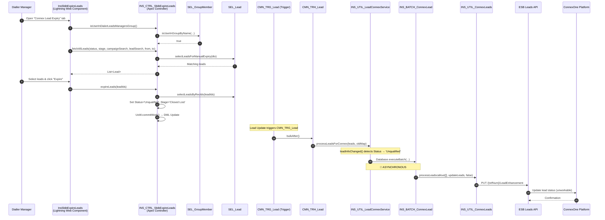
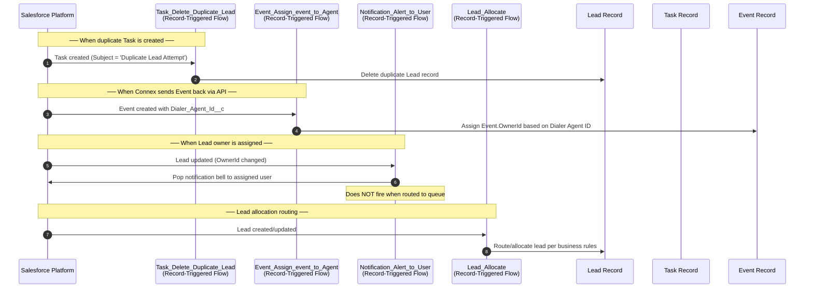

# Lead-to-Connex Execution Flow — Sequence Diagram

## Path A: Real-Time Dispatch (Lead Insert/Update)

```mermaid
sequenceDiagram
    autonumber
    participant User as User / API / Flow
    participant TRG as CMN_TRG_Lead<br/>(Apex Trigger)
    participant Factory as CMN_FACTORY_TriggerHandler
    participant TRH as CMN_TRH_Lead<br/>(Trigger Handler)
    participant LT as INS_UTIL_LeadTrigger<br/>(Orchestrator)
    participant DupSvc as checkForDuplicates<br/>(Duplicate Logic)
    participant CmpSvc as Campaign Sync<br/>(syncLeadsWithCampaigns)
    participant MaintSvc as maintainLeadStatus /<br/>assignOwnerFromDialerAgentId
    participant CmpMbr as createCampaignMembers
    participant ConnexSvc as INS_UTIL_LeadConnexService
    participant ConnexSupp as INS_UTIL_LeadConnexSupport
    participant ConnexDec as INS_UTIL_LeadConnexDecisionService
    participant Batch as INS_BATCH_ConnexLead<br/>(Batch Job)
    participant ConnexUtil as INS_UTIL_ConnexLeads
    participant TokenHelper as CMN_Generate_Token_Helper
    participant OAuthAPI as OAuth Token Endpoint<br/>(INS_InsuranceClaimsAccess)
    participant DTO as INS_DTO_ConnexLeads<br/>(Payload Builder)
    participant LeadsAPI as INS_Leads_API<br/>(HTTP Client)
    participant ESB as ESB Leads API<br/>(External)
    participant Connex as ConnexOne Platform<br/>(External)
    participant RespDTO as INS_DTO_ConnexLeadsResponse /<br/>INS_DTO_UpdateConnexLeadResponse
    participant DupFlow as Task_Delete_Duplicate_Lead<br/>(Flow)
    participant SEL_Lead as SEL_Lead<br/>(Selector)
    participant SEL_Camp as SEL_Campaign<br/>(Selector)
    participant SEL_User as SEL_User<br/>(Selector)
    participant SEL_PQ as INS_SEL_Leads_ProductQueueAllocation<br/>(Selector)
    participant SEL_CM as INS_SEL_CampaignMember<br/>(Selector)
    participant MDT as INS_Insurance_Lead_Settings__mdt<br/>(Custom Metadata)

    User->>TRG: Insert / Update Lead
    TRG->>Factory: createHandler(CMN_TRH_Lead.class)
    Factory->>TRH: instantiate & invoke lifecycle

    Note over TRH: ══ BEFORE INSERT / BEFORE UPDATE ══

    TRH->>LT: initializeState()
    Note over LT: Reset duplicate tracking sets

    rect rgb(230, 245, 255)
        Note over TRH,LT: Format Numbers (Before Insert only)
        TRH->>LT: formatNumbers(leads)
        LT->>SEL_PQ: selectProductQueueByIds()
        SEL_PQ-->>LT: Product allocations
        LT->>MDT: getInstance('Dialer_Leads')
        MDT-->>LT: Settings (ProductFamily, LeadType, LeadDate)
        Note over LT: Normalize +27 format for valid product leads
    end

    rect rgb(255, 240, 230)
        Note over TRH,LT: Duplicate Detection (Before Insert only)
        TRH->>LT: checkForDuplicates(leads)
        LT->>DupSvc: getLeadsEligibleForDuplicateCheck()
        DupSvc->>SEL_PQ: selectProductQueueByIds() [cached]
        DupSvc->>DupSvc: findIntraBatchDuplicates()
        DupSvc->>SEL_Lead: Query existing leads by duplicate key
        SEL_Lead-->>DupSvc: Existing matches
        DupSvc->>DupSvc: applyDuplicateRulesAndAddErrors()
        Note over DupSvc: Mark duplicates: Referred_System_Reference_Number__c = 'Duplicate'<br/>Create Task records for tracking
    end

    rect rgb(230, 255, 230)
        Note over TRH,LT: Campaign Sync (Insert & Update)
        TRH->>LT: syncLeadsWithCampaigns(leads, oldMap)
        LT->>CmpSvc: getUpdatedCampaignSourceIds()
        CmpSvc->>SEL_Camp: selectByCampaignSourceIds()
        SEL_Camp-->>CmpSvc: Campaign records
        CmpSvc->>CmpSvc: updateLeadsWithCampaignNames()
        Note over CmpSvc: Set Campaign_Name__c & Dialler_Queue_ID__c on Lead
    end

    rect rgb(255, 255, 220)
        Note over TRH,LT: Status Maintenance (Update only)
        TRH->>LT: maintainLeadStatus(leads)
        Note over MaintSvc: If Qualified + has ref# + no Account → Status = 'Onboarding'

        TRH->>LT: assignOwnerFromDialerAgentId(leads, oldMap)
        LT->>MaintSvc: identifyChangedAgentLeads()
        MaintSvc->>SEL_User: selectUserByEmployeeNumber()
        SEL_User-->>MaintSvc: User map
        MaintSvc->>MaintSvc: updateLeadOwners()
    end

    Note over TRH: ══ AFTER INSERT / AFTER UPDATE ══

    TRH->>LT: getNonDuplicateLeads(leads)
    LT-->>TRH: Non-duplicate leads

    rect rgb(230, 255, 230)
        Note over TRH,CmpMbr: Campaign Member Creation
        TRH->>LT: createCampaignMembers(leads, oldMap, isInsert)
        LT->>CmpMbr: getSuccessfulLeads()
        CmpMbr->>SEL_Camp: selectByCampaignSourceIds()
        CmpMbr->>SEL_CM: selectCampaignMembersByLeadAndCampaignIds()
        SEL_CM-->>CmpMbr: Existing members
        CmpMbr->>SEL_Lead: selectLeadsEligibleForCourtesySMS()
        SEL_Lead-->>CmpMbr: Eligible Lead IDs
        CmpMbr->>CmpMbr: prepareCampaignMembers()
        Note over CmpMbr: Source Campaign + Courtesy SMS Campaign<br/>(INS_CRTSY_BUSHR_SMS or INS_CRTSY_NONBUSHR_SMS)
        CmpMbr->>CmpMbr: registerCampaignMembers() → UoW.commitWork()
    end

    rect rgb(255, 230, 230)
        Note over TRH,ConnexSvc: ══ CONNEX PROCESSING ══
        TRH->>LT: processLeadsForConnex(leads, oldMap)
        Note over TRH: Guard: skipConnexCallout=false && !System.isBatch()

        LT->>ConnexSvc: processLeadsForConnex(leads, oldMap)

        ConnexSvc->>ConnexSupp: filterEligibleLeads(leads)
        Note over ConnexSupp: Exclude: no Id, Ref# = 'Duplicate'
        ConnexSupp-->>ConnexSvc: Eligible leads

        ConnexSvc->>ConnexSupp: fetchProductAllocations(leads)
        ConnexSupp->>SEL_PQ: selectProductQueueByIds() [cached]
        SEL_PQ-->>ConnexSupp: Product map

        loop For each eligible lead
            ConnexSvc->>ConnexSupp: isValidProductLead(lead, product)
            ConnexSupp->>MDT: getInstance('Dialer_Leads') [cached]
            Note over ConnexSupp: ProductFamily=Insurance, LeadType=SBIB Dialler,<br/>CreatedDate >= threshold

            ConnexSvc->>ConnexDec: eligibleForConnexInsert(lead, oldMap)
            ConnexDec->>ConnexSupp: isPreferredContactTimeNullOrPast(lead)
            Note over ConnexSupp: If preferred time is future → NOT eligible (deferred to batch)

            ConnexSvc->>ConnexDec: hasProductChanged(lead, oldMap)
            ConnexSvc->>ConnexDec: leadInfoChanged(newLead, oldLead)

            alt Path 1: Fresh Insert (eligible, no future preferred time)
                ConnexSvc->>ConnexSvc: result.qualifiedLeads.add(lead)
            else Path 2: Product Changed
                ConnexSvc->>ConnexSvc: cloneLeadForConnex(lead)
                ConnexSvc->>ConnexSvc: result.qualifiedLeads.add(clone)
            else Path 3: Info Changed (already has Connex ref#)
                ConnexSvc->>ConnexSvc: result.qualifiedLeads.add(lead)
            end
        end

        Note over ConnexSvc: ── ASYNC BOUNDARY ──
        ConnexSvc->>Batch: Database.executeBatch(INS_BATCH_ConnexLead, 15)
        Note over ConnexSvc,Batch: 🔀 ASYNCHRONOUS: Batch job queued
    end

    rect rgb(240, 230, 255)
        Note over Batch: ══ BATCH EXECUTION (Async Context) ══

        Batch->>Batch: start(bc)
        Batch->>SEL_Lead: selectDialerLeadsByRecIds(leadIds)
        SEL_Lead-->>Batch: Lead records

        Batch->>Batch: execute(bc, scope)
        Note over Batch: Split: newLeads (no ref#) vs updateLeads (has ref#)
        Batch->>ConnexUtil: processLeadscallout(newLeads, updateLeads, expireLeads)

        ConnexUtil->>ConnexUtil: validateAndClassifyLead() for each lead
        Note over ConnexUtil: Validate mobile ≥ 6 chars, classify qualified vs unqualified

        ConnexUtil->>TokenHelper: getAccessToken()
        TokenHelper->>OAuthAPI: POST callout:INS_InsuranceClaimsAccess<br/>(client_credentials grant)
        OAuthAPI-->>TokenHelper: { "access_token": "..." }
        TokenHelper-->>ConnexUtil: Bearer token

        ConnexUtil->>SEL_User: getUsersByIds(ownerIds)
        SEL_User-->>ConnexUtil: User → EmployeeNumber map

        alt POST — New Leads
            ConnexUtil->>ConnexUtil: processQualifiedLeadsPost()
            ConnexUtil->>DTO: createWrapperFromLead(lead, employeeId, null)
            DTO-->>ConnexUtil: LeadWrapper
            ConnexUtil->>DTO: generateRequestBody(wrappers)
            DTO-->>ConnexUtil: JSON payload

            ConnexUtil->>LeadsAPI: new INS_Leads_API(json, token, 'POST')
            LeadsAPI->>LeadsAPI: setHeaders()
            Note over LeadsAPI: Bearer token, X-IBM-Client-Id,<br/>X-IBM-Client-Secret, x-env-key,<br/>X-Client-Certificate (5 parts)
            LeadsAPI->>LeadsAPI: createRequest() → endpoint: callout:INS_Insurance_Leads
            LeadsAPI->>ESB: HTTP POST (Lead payload)
            ESB->>Connex: Forward to ConnexOne
            Connex-->>ESB: Response (Connex ID or error)
            ESB-->>LeadsAPI: JSON Response
            LeadsAPI-->>ConnexUtil: getResponseBody()

            ConnexUtil->>LeadsAPI: processCreateLeadResponse(json)
            LeadsAPI->>RespDTO: INS_DTO_ConnexLeadsResponse.parse()
            RespDTO-->>LeadsAPI: Parsed DTO
            LeadsAPI->>LeadsAPI: buildLeadsToUpdate(responseItems)
            Note over LeadsAPI: Success → Referred_System_Reference_Number__c = contact_data_id<br/>Failure → Dialer_Failure_Reason__c = error message
            LeadsAPI-->>ConnexUtil: List<Lead> to update

        else PUT — Existing Leads (update/expire)
            ConnexUtil->>ConnexUtil: processQualifiedLeadsPut()
            ConnexUtil->>ConnexUtil: buildPutPayload(lead, empId, settings, expireLeads)
            ConnexUtil->>DTO: generatePutRequestBody(lead, employeeId, statusCode)
            Note over DTO: If expiring: statusCode = INS_LeadExpireCode__c
            DTO-->>ConnexUtil: JSON payload

            ConnexUtil->>LeadsAPI: new INS_Leads_API(json, token, 'PUT', refNum)
            LeadsAPI->>LeadsAPI: createRequest() → endpoint: callout:INS_Insurance_Leads/{refNum}/LeadEnhancement
            LeadsAPI->>ESB: HTTP PUT (Update payload)
            ESB->>Connex: Forward update to ConnexOne
            Connex-->>ESB: Response
            ESB-->>LeadsAPI: JSON Response
            LeadsAPI-->>ConnexUtil: getResponseBody()

            ConnexUtil->>ConnexUtil: handlePutResponse()
            ConnexUtil->>RespDTO: INS_DTO_UpdateConnexLeadResponse.parse()
            RespDTO-->>ConnexUtil: Parsed DTO
            alt Success
                ConnexUtil->>LeadsAPI: processUpdateLeadResponse(json)
                ConnexUtil->>ConnexUtil: processSuccessfulPutResponse()
            else Failure
                ConnexUtil->>ConnexUtil: extractErrorMessage(dto, defaultMsg)
                ConnexUtil->>ConnexUtil: buildErrorLead(leadId, message)
            end
        end

        ConnexUtil->>ConnexUtil: UoW.commitWork()
        Note over ConnexUtil: Persist: Referred_System_Reference_Number__c<br/>or Dialer_Failure_Reason__c on Lead records

        Batch->>Batch: finish(bc)
        Note over Batch: Log totals
    end

    Note over DupFlow: ── SEPARATE ASYNC FLOW ──
    Note over DupFlow: Task_Delete_Duplicate_Lead (Record-Triggered Flow)<br/>Fires when Task with Subject='Duplicate Lead Attempt' is created<br/>→ Deletes the duplicate Lead record
```

## Path B: Scheduled Retry (Every 30 Minutes)

## Path C: Scheduled Expiry (Daily 8:15 PM)

## Path D: Manual Retry via LWC Failed Report

## Path E: Manual Expiry via LWC

## Supporting Flows (Async / Record-Triggered)

## Component Legend

| Symbol | Component Type |
|--------|---------------|
| Solid arrow (→) | Synchronous call |
| 🔀 ASYNCHRONOUS | Async boundary (Database.executeBatch / Schedulable) |
| rect colored block | Logical grouping of related operations |
| Note | Processing details / conditions |

## Named Credentials & External Credentials

| Named Credential | Purpose | Used By |
|-----------------|---------|---------|
| `INS_InsuranceClaimsAccess` | OAuth token endpoint | CMN_Generate_Token_Helper |
| `INS_InsuranceClaimsAccessToken` | Client ID + Secret for OAuth | CMN_Generate_Token_Helper |
| `INS_Insurance_Leads` | ESB Leads API endpoint + IBM credentials + certificates | INS_Leads_API |
